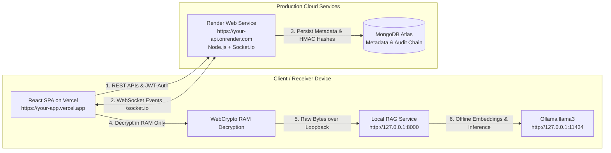

# Cipher Vault - Production Cloud Deployment Guide

This guide details how to deploy the **Cipher Vault** platform to production with:
- **Backend API & Real-time WebSockets**: Hosted on [Render](https://render.com) (Node.js Express + Socket.io)
- **Frontend SPA**: Hosted on [Vercel](https://vercel.com) (React 18 + Vite)
- **Database**: [MongoDB Atlas](https://www.mongodb.com/atlas) (Managed Replica Set)
- **Offline AI & Vector Pipeline**: Runs strictly **locally on the client/receiver device** (FastAPI + SentenceTransformers + ChromaDB + Ollama `llama3`)

---

## 1. System Topology & Zero-Trust Model



> [!IMPORTANT]
> **Zero-Knowledge Core Cryptography**:
> The Express backend on Render stores only AES-256-GCM encrypted blobs and HMAC-SHA256 audit hashes. Decryption keys and plaintext contents are **never** transmitted to Render or Vercel. All document Q&A queries and embeddings are processed strictly on the client machine via `127.0.0.1:8000`.

---

## 2. Step 1: MongoDB Atlas Configuration

1. Log in to [MongoDB Atlas](https://cloud.mongodb.com) and create or select an **M0 (Free)** or **Serverless / Dedicated** cluster.
2. **Database Access**:
   - Navigate to **Security > Database Access**.
   - Click **Add New Database User**.
   - Create a user with **Password Authentication** (e.g. `ciphervault_admin`) and assign `readWriteAnyDatabase` or permissions for the `cipher_vault` database.
3. **Network Access (IP Whitelist)**:
   - Navigate to **Security > Network Access**.
   - Click **Add IP Address**.
   - Select **Allow Access from Anywhere** (`0.0.0.0/0`) since Render cloud instances use dynamic egress IP addresses.
4. **Get Connection String**:
   - Go to **Database > Connect > Drivers > Node.js**.
   - Copy the SRV connection URI:
     ```text
     mongodb+srv://<username>:<password>@cluster0.abcde.mongodb.net/cipher_vault?retryWrites=true&w=majority
     ```

---

## 3. Step 2: Backend Deployment on Render

1. Log in to [Render](https://dashboard.render.com).
2. Click **New + > Web Service** and link your Cipher Vault repository.
3. Configure the service parameters:
   - **Name**: `cipher-vault-api` (or your preferred name)
   - **Region**: Choose the region closest to your users (e.g., `Oregon (US West)` or `Frankfurt (EU Central)`)
   - **Branch**: `main`
   - **Root Directory**: `backend`
   - **Runtime**: `Node`
   - **Build Command**: `npm install`
   - **Start Command**: `node src/server.js` (or `npm start`)
   - **Instance Type**: `Free` or `Starter`

4. **Environment Variables**:
   Under **Environment Variables**, add the following:

   | Key | Value / Example | Description |
   |---|---|---|
   | `NODE_ENV` | `production` | Enables production security guards |
   | `PORT` | `5000` | Render assigns this automatically, defaults to 5000 |
   | `MONGO_URI` | `mongodb+srv://...` | MongoDB Atlas connection string from Step 1 |
   | `CLIENT_ORIGIN` | `https://<your-app>.vercel.app,https://*.vercel.app` | Comma-separated allowed frontend origins for CORS and Socket.io |
   | `JWT_ACCESS_SECRET` | *(64-char random hex)* | `openssl rand -hex 32` |
   | `JWT_REFRESH_SECRET` | *(64-char random hex)* | `openssl rand -hex 32` |
   | `MFA_ENC_KEY` | *(64-char random hex)* | Exactly 64 hex characters (32 bytes) for AES-GCM TOTP encryption |
   | `AUDIT_HMAC_KEY` | *(64-char random hex)* | Append-only HMAC-SHA256 audit chain key (`openssl rand -hex 32`) |
   | `COOKIE_SAMESITE` | `none` | Required for cross-site cookie transmission between Vercel & Render |
   | `STORAGE_DRIVER` | `disk` | `disk` for file storage (or attach a Render Persistent Disk at `/var/data`) |
   | `STORAGE_DIR` | `./data/blobs` | Directory path for encrypted ciphertexts |

   *(Optional breach alerting variables: `SMTP_HOST`, `SMTP_PORT`, `SMTP_USER`, `SMTP_PASS`, `SMTP_FROM`, `TWILIO_ACCOUNT_SID`, `TWILIO_AUTH_TOKEN`, `TWILIO_FROM_PHONE`)*

5. **Health Check Path**:
   - Under **Advanced Settings**, set **Health Check Path** to `/health`.
6. Click **Create Web Service**. Wait for the deployment to finish and copy your Render URL (e.g., `https://cipher-vault-api.onrender.com`).

---

## 4. Step 3: Frontend Deployment on Vercel

1. Log in to [Vercel](https://vercel.com) and click **Add New... > Project**.
2. Import the `Cipher-2` repository.
3. Configure the Project Settings:
   - **Framework Preset**: `Vite`
   - **Root Directory**: Click **Edit** and select `frontend`.
   - **Build Command**: `npm run build`
   - **Output Directory**: `dist`
   - **Install Command**: `npm install`

4. **Environment Variables**:
   Add the following environment variables in the Vercel dashboard:

   | Key | Value | Description |
   |---|---|---|
   | `VITE_API_URL` | `https://cipher-vault-api.onrender.com` | Your deployed Render backend URL (no trailing slash) |
   | `VITE_SOCKET_URL` | `https://cipher-vault-api.onrender.com` | Your deployed Render WebSocket URL |
   | `VITE_LOCAL_AI_URL` | `http://127.0.0.1:8000` | Loopback address for the local client AI service |

5. **SPA Routing**:
   The repository includes [frontend/vercel.json](file:///c:/MegaProject/Cipher-2/frontend/vercel.json) configured with:
   ```json
   {
     "rewrites": [
       {
         "source": "/(.*)",
         "destination": "/index.html"
       }
     ]
   }
   ```
   This guarantees that refreshing routes like `/dashboard`, `/analytics`, or `/login` always loads the SPA without 404 errors.

6. Click **Deploy**. Vercel will build and assign your production URL (e.g. `https://cipher-vault.vercel.app`).

7. **Synchronize CORS on Render**:
   - Go back to Render > `cipher-vault-api` > **Environment**.
   - Ensure `CLIENT_ORIGIN` includes your exact Vercel URL:
     ```text
     https://cipher-vault.vercel.app,https://*.vercel.app
     ```
   - Render will automatically trigger a zero-downtime redeploy.

---

## 5. Step 4: Running the Local Client AI Pipeline

When a recipient opens a document in the Vercel web app and chooses to analyze it with AI:

1. **Prerequisites on Client Machine**:
   - Python 3.10+
   - [Ollama](https://ollama.com) installed with the `llama3` model:
     ```bash
     ollama run llama3
     ```
2. **Start the Local AI Microservice**:
   On the client machine (from the repository root):
   ```bash
   cd ai-service
   pip install -r requirements.txt
   python -m uvicorn app.main:app --host 127.0.0.1 --port 8000
   ```
3. The frontend on Vercel connects directly to `http://127.0.0.1:8000` over the client's loopback interface. Document bytes decrypted in browser RAM are sent only to this local service; they are **never** uploaded to cloud LLMs or cloud servers.

---

## 6. Post-Deployment Verification Checklist

- [ ] **Health Check**: Visit `https://<your-render-url>/health` in your browser. Expected response: `{"status":"ok"}`.
- [ ] **User Registration & MFA**: Open your Vercel URL, register a new user, scan the TOTP QR code into Google Authenticator or 1Password, and confirm successful login.
- [ ] **Real-Time HUD**: Check the top-bar HUD on the dashboard. The **WebSocket** indicator should display **Connected** in green.
- [ ] **Document Sealing**: Upload and seal a document (with mandatory geofencing and delivery mode). Confirm the sender receives a secret key or registered vault key confirmation.
- [ ] **Context-Gated Decryption**: Open the document as the recipient, verify MFA code and GPS proximity, and confirm the document displays inside the decrypted browser viewer.
- [ ] **Audit Trail**: Check the Audit log page to ensure the cryptographic HMAC-SHA256 chain remains **INTACT**.
